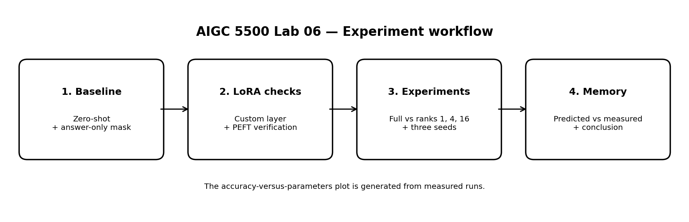
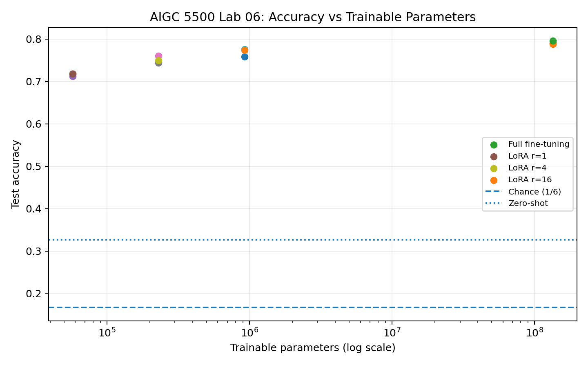

# AIGC 5500 Lab 06 — Fine-Tune with LoRA

This repository implements the four pieces in the Lab 06 handout using the professor-provided `HuggingFaceTB/SmolLM2-135M` starter harness and the Emotion dataset (`dair-ai/emotion`).

## Repository contents

- `lab06_starter.py` — unchanged professor starter file.
- `answer_only_loss.py` — custom answer-only target mask (scores only the label answer token).
- `lora_layer.py` — custom LoRA linear layer implementation and q/v projection replacement helper.
- `verify_lora.py` — initialization equality, parameter count, merged-layer, and PEFT equivalence checks.
- `run_lab06.py` — zero-shot baseline, parameter-count checks, all 15 controlled training runs, memory accounting, CSV/JSON outputs, and figure generation.
- `memory.py` — readable predicted-versus-measured memory comparison script.
- `lab06_workflow.png` — diagram of the lab workflow and components.
- `results/` — directory containing experiment outputs:
  - `experiment_results.csv` — metrics for all 15 training runs across methods and seeds.
  - `lora_parameter_counts.csv` — parameter counts and formula checks for ranks 1, 4, and 16.
  - `run_metadata.json` — hardware, software versions, and experiment configuration metadata.
  - `accuracy_vs_trainable_parameters.png` — plot of test accuracy vs. trainable parameters.

## Setup

```bash
python -m venv .venv
# Windows PowerShell:
.venv\Scripts\Activate.ps1
# macOS/Linux:
source .venv/bin/activate

python -m pip install --upgrade pip
pip install -r requirements.in
pip freeze > requirements.txt
```

## Prediction — written before running the sweep

**Pre-run prediction:** I expect LoRA rank 16 to be closer to full fine-tuning than rank 1 because a higher rank gives the adapter more trainable directions to adapt the representations. I expect rank 1 to have the smallest trainable parameter and optimizer-state footprint, but it may have lower capacity and lower accuracy. I do not assume rank 16 will completely match full fine-tuning: the result depends on the task, optimization, data sample, and fixed update budget. This prediction is retained regardless of the measured outcome.

## Workflow Figure



## Accuracy vs Trainable Parameters Figure



## Run

First verify the starter environment as the assignment instructs:

```bash
python lab06_starter.py
```

Then run the verification checks, controlled experiments, and memory analysis:

```bash
python verify_lora.py
python run_lab06.py
python memory.py
```

The execution pipeline performs:
1. Zero-shot evaluation on the fixed test set (500 examples).
2. Answer-only loss mask assertions (exact 1 answer token scored per example).
3. Custom LoRA parameter-count and per-layer formula checks for ranks 1, 4, and 16.
4. 12 controlled training runs with answer-only loss: Full fine-tuning and LoRA (ranks 1, 4, 16) across 3 random seeds (0, 1, 2).
5. 3 controlled training runs with all-token loss: LoRA rank 16 across 3 random seeds (0, 1, 2).

All training runs use identical hyperparameters: 600 training examples, 500 test examples, 120 steps, batch size 8, and data seed 0. Learning rates are fixed prior to evaluation: `5e-5` for full fine-tuning and `1e-3` for LoRA.

## Hardware

- **Hardware/device:** NVIDIA Tesla T4 GPU (CUDA)
- **PyTorch version:** `2.11.0+cu130`
- **Total elapsed time:** 241.45 seconds (~4 minutes)
- **Dataset / steps / batch size:** `emotion` (n_train=600, n_test=500), Steps: 120, Batch Size: 8

## Results

### Zero-Shot Baseline & Answer-Only Loss

- **Zero-shot accuracy:** `0.3260` (32.60%)
- **Chance accuracy:** `1/6 = 0.1667` (16.67%)
- **Difference from chance:** `+0.1593` (+15.93 percentage points above chance)

**Explanation of All-Token vs Answer-Only Loss:**
The starter's `all_tokens_labels` scores every non-padding token in the sequence, including the prompt text (e.g., `"Text: i feel happy \nEmotion:"`). This trains the model to predict the prompt text itself rather than specializing in generating the target label token. `answer_only_labels` masks out all prompt positions with `-100` and scores only the single label token following the cue. This aligns the loss directly with the classification metric being evaluated.

### Custom LoRA Verification

Running `verify_lora.py` confirms:
1. **Zero Initialization:** $B$ is initialized to zero and $A$ to Kaiming uniform values. At initialization, $( \alpha / r ) B A = 0$, so `LoRALinear` outputs match the frozen base layer exactly.
2. **Parameter Count Formula:** Trainable parameters in `LoRALinear` equal $r \times (d_{\text{in}} + d_{\text{out}})$.
3. **Merged Layer Output:** Merging $W_{\text{eff}} = W_{\text{base}} + \frac{\alpha}{r} B A$ yields identical outputs to the two-path forward pass.
4. **PEFT Equivalence:** After copying weights $A$ and $B$, our custom `LoRALinear` outputs match Hugging Face `peft.LoraModel` within numerical tolerance ($< 10^{-5}$).

#### Trainable Parameter Breakdown by Rank (q_proj & v_proj targeted across 30 decoder layers = 60 layers)

| Configuration | Targeted Layers | Formula Parameters | Total Parameters | Trainable Parameters | Trainable % |
| :--- | :---: | :---: | :---: | :---: | :---: |
| **Full Fine-Tuning** | All | N/A | 134,515,008 | 134,515,008 | 100.000% |
| **LoRA Rank 1** | 60 | $60 \times 1 \times (576 + 384) = 57,600$ | 134,572,608 | 57,600 | 0.0428% |
| **LoRA Rank 4** | 60 | $60 \times 4 \times (576 + 384) = 230,400$ | 134,745,408 | 230,400 | 0.1710% |
| **LoRA Rank 16** | 60 | $60 \times 16 \times (576 + 384) = 921,600$ | 135,436,608 | 921,600 | 0.6805% |

### Rank Sweep & Loss Comparison Results

| Method | Loss Type | Learning Rate | Seed 0 Acc | Seed 1 Acc | Seed 2 Acc | Mean Accuracy | Acc vs Zero-Shot | Acc vs Chance |
| :--- | :--- | :---: | :---: | :---: | :---: | :---: | :---: | :---: |
| **Zero-Shot Baseline** | None | N/A | — | — | — | **32.60%** | +0.00% | +15.93% |
| **Full Fine-Tuning** | Answer-Only | `5e-5` | 79.00% | 78.80% | 79.60% | **79.13%** | +46.53% | +62.46% |
| **LoRA Rank 1** | Answer-Only | `1e-3` | 71.80% | 71.20% | 71.80% | **71.60%** | +39.00% | +54.93% |
| **LoRA Rank 4** | Answer-Only | `1e-3` | 76.00% | 74.40% | 75.00% | **75.13%** | +42.53% | +58.46% |
| **LoRA Rank 16** | Answer-Only | `1e-3` | 77.60% | 75.80% | 77.40% | **76.93%** | +44.33% | +60.26% |
| **LoRA Rank 16** | All-Token | `1e-3` | 71.20% | 71.00% | 70.40% | **70.87%** | +38.27% | +54.20% |

#### Key Findings from the Sweep:
1. **Rank vs. Performance:** Increasing LoRA rank improves classification accuracy ($r=1$: 71.60% $\rightarrow$ $r=4$: 75.13% $\rightarrow$ $r=16$: 76.93%). Higher rank provides a higher-dimensional subspace for weight updates, allowing the adapter to capture more complex task features.
2. **LoRA vs. Full Fine-Tuning:** LoRA rank 16 achieves **76.93%** accuracy, coming within **2.20 percentage points** of full fine-tuning (**79.13%**) while training only **0.68%** of the parameters.
3. **Answer-Only vs. All-Token Loss:** Training rank 16 with `all_tokens` loss reduced test classification accuracy from **76.93% to 70.87%** (a decrease of **6.06 percentage points**). Scoring the prompt forces gradient updates to optimize language modeling on prompt text, distracting the adapter from specializing on the target classification token.

### Memory Analysis: Predicted vs. Measured

Predictions are based on 32-bit floating point precision (4 bytes per parameter):
- **Weight Bytes:** $4 \times \text{Total Parameters}$
- **Gradient Bytes:** $4 \times \text{Trainable Parameters}$
- **Adam Optimizer Bytes:** $8 \times \text{Trainable Parameters}$ (first and second moments: $m_t$ and $v_t$)
- **Total Predicted Training State Memory:** $4 \times \text{Total Params} + 12 \times \text{Trainable Params}$

#### Memory Comparison Table

| Method / Rank | Trainable Params | Pred. Weight (MB) | Pred. Grad (MB) | Pred. Adam (MB) | Pred. Total State (MB) | Measured Peak CUDA (MB) |
| :--- | :---: | :---: | :---: | :---: | :---: | :---: |
| **Full Fine-Tuning** | 134,515,008 | 538.06 MB | 538.06 MB | 1,076.12 MB | **2,152.24 MB** | **3,456.31 MB** |
| **LoRA Rank 1** | 57,600 | 538.29 MB | 0.23 MB | 0.46 MB | **538.98 MB** | **1,713.06 MB** |
| **LoRA Rank 4** | 230,400 | 538.98 MB | 0.92 MB | 1.84 MB | **541.75 MB** | **1,715.26 MB** |
| **LoRA Rank 16** | 921,600 | 541.75 MB | 3.69 MB | 7.37 MB | **552.81 MB** | **1,724.48 MB** |

#### Why Measured Peak CUDA Memory exceeds Theoretical Prediction:
The theoretical prediction accounts strictly for persistent state (model weights, stored gradients, and optimizer momentum tensors). In practice, peak CUDA memory recorded during training is significantly higher (~1.72 GB for LoRA vs. ~0.55 GB predicted state; ~3.46 GB for Full FT vs. ~2.15 GB predicted state). This difference is due to:
1. **Activation Memory:** Intermediate activation tensors stored during the forward pass for computing backward gradients.
2. **Temporary Tensors & Workspace:** PyTorch autograd engine workspaces, loss computation buffers, and model attention matrices.
3. **CUDA Allocator Overhead:** PyTorch memory caching allocator fragmentations and pre-allocated memory pools.

## Conclusion

In these experiments, LoRA rank 16 saved **99.31%** of trainable parameters (921,600 vs. 134,515,008) and reduced predicted optimizer state memory by **1,068.75 MB** (from 1,076.12 MB down to 7.37 MB) compared with full fine-tuning. Its test accuracy of **76.93%** was slightly lower than full fine-tuning (**79.13%**), but significantly higher than the zero-shot baseline (**32.60%**). Rank 1 achieved **71.60%** accuracy, demonstrating that parameter efficiency comes at a minor cost in capacity. Furthermore, answer-only loss proved superior to all-token loss by **6.06 percentage points**, proving the importance of scoring only the target answer token.

These results support the claim that low-rank adaptation can achieve near-full fine-tuning performance at a fraction of the computational and optimizer memory cost. The evidence is limited to one 135M parameter model (`SmolLM2-135M`), one dataset (`emotion`), a fixed sample size (600 train / 500 test), a fixed budget of 120 steps, three random seeds, and hardware-dependent timing and memory measurements.

## Known Limitations

- **Model Scale:** Evaluated exclusively on `SmolLM2-135M`; larger models (e.g., 7B+) may show different scaling behaviors.
- **Dataset Scope:** Experiments were conducted on single-token emotion classification; multi-token generation tasks were not evaluated.
- **Hyperparameter Tuning:** A fixed learning rate (`1e-3` for LoRA, `5e-5` for Full FT) was used across ranks without per-rank grid search.
- **Sample Size & Seeds:** Results reflect 3 random seeds on 600 training examples under a fixed 120-step budget.

